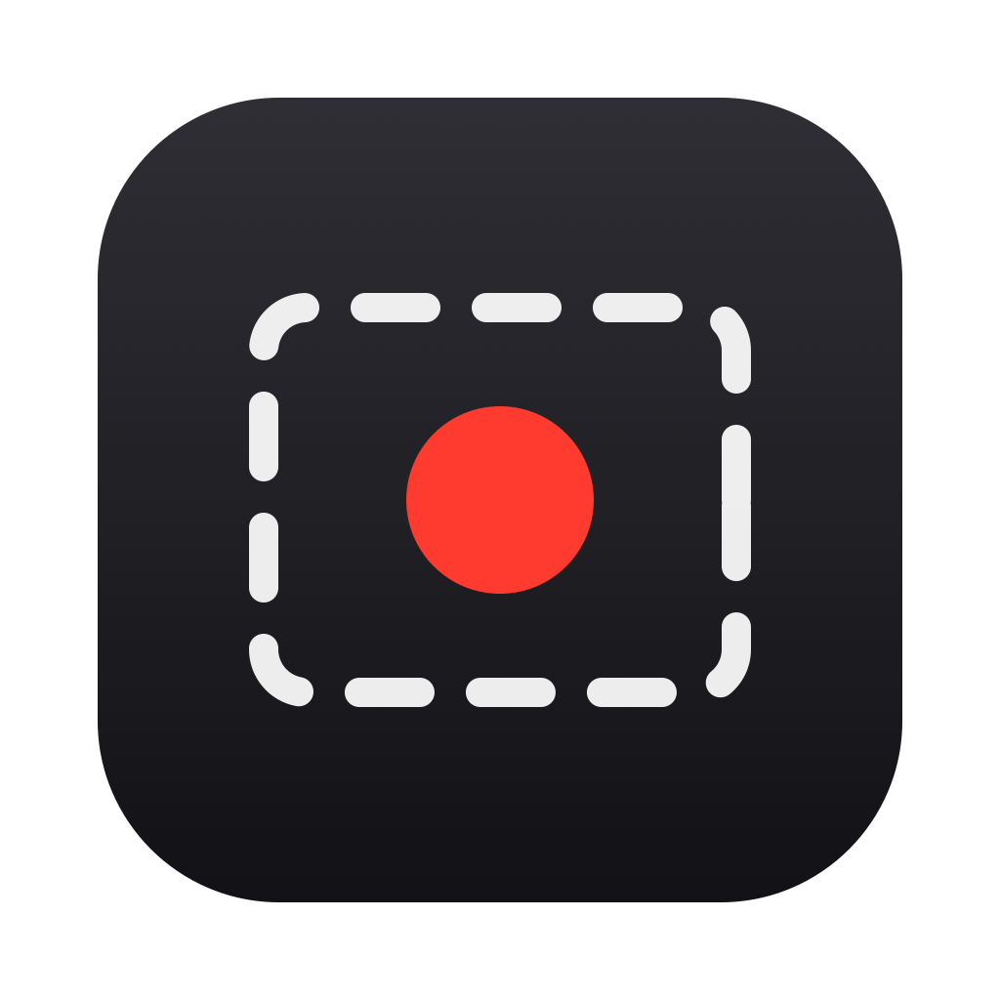
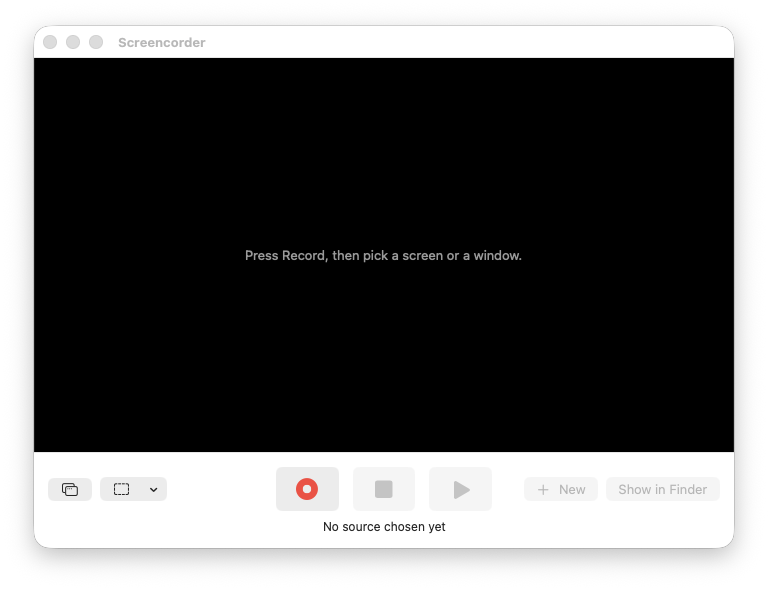

<p align="center">
  
</p>

# Screencorder

A small macOS screen recorder. Pick a window, a screen or an area, press Record, and get an MP4.

<p align="center">
  
</p>

## Features

- **Record a window or a whole screen**, chosen with the macOS picker.
- **Record an area**: draw a rectangle on the screen. Hold Shift while dragging to keep its proportions.
- **YouTube shapes**: draw an area locked to 16:9 (saved as 1080p, 1440p or 4K) or to 9:16 for Shorts (saved as 1080 × 1920).
- **See what is being recorded**: once an area is chosen, the rest of the screen is dimmed. The dimming is not part of the video, and clicks pass through it.
- **Record, Stop and Play** buttons, with playback of the last recording in the window.
- **MP4 output**: H.264 video with system audio (AAC), saved to `~/Movies/Screen Recordings/`.

The microphone is not recorded.

## Requirements

macOS 15.2 or later, on Apple silicon or Intel.

## Install

1. Download `Screencorder-1.0.zip` from the [latest release](https://github.com/ncserny/screencorder/releases/latest) and unzip it.
2. Move `Screencorder.app` to your Applications folder.
3. Open it. The app is not notarised by Apple, so macOS blocks the first launch. Go to System Settings, Privacy & Security, scroll down and click **Open Anyway**.

## Use

1. Press **Record**. The first time, macOS asks which window or screen to record, and recording starts once you pick.
2. Press **Stop**. The MP4 is saved and loaded into the window.
3. Press **Play** to watch it, or **Show in Finder** to get the file.

To record an area, click the dashed-rectangle button, choose a shape, and drag on the screen. Esc cancels. Then press Record.

**New** clears the last recording from the window. The file stays on disk.

### Screen Recording permission

Recording a window or a screen goes through the macOS picker and needs no extra permission. Recording an area does: the first time, macOS asks for it. Allow Screencorder under System Settings, Privacy & Security, Screen & System Audio Recording, then choose the area again.

## Build from source

You need the Xcode command line tools (`xcode-select --install`). Xcode itself is not required.

```bash
./build.sh
```

This makes `build/Screencorder.app` for your Mac.

```bash
./build.sh --release
```

This makes a universal app (Apple silicon and Intel) in `build/release/`, with a zip next to it.

### Keeping the permission across rebuilds

By default the build is signed ad hoc, which means macOS treats every rebuild as a new app and asks for the Screen Recording permission again. To avoid that, create a self-signed code-signing certificate named `Screen Recorder Local Signing` (Keychain Access, Certificate Assistant, Create a Certificate, with the type set to Code Signing). `build.sh` uses it when it finds it. Set `SCREENCORDER_IDENTITY` to use a certificate with another name.

### The logo

`scripts/make-icon.swift` draws the logo:

```bash
swift scripts/make-icon.swift assets/logo.png 1024
```

## How it works

Screencorder is a single-window SwiftUI app built on ScreenCaptureKit. `SCContentSharingPicker` chooses a window or screen, `SCStream` captures it, and `SCRecordingOutput` writes the MP4. An area recording captures the display with a source rectangle, leaving the app's own windows out.

## License

Apache License 2.0. See [LICENSE](LICENSE).
